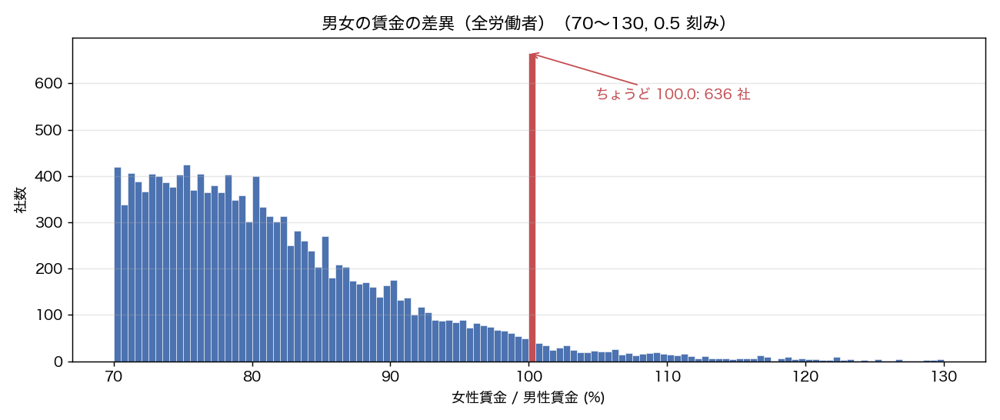
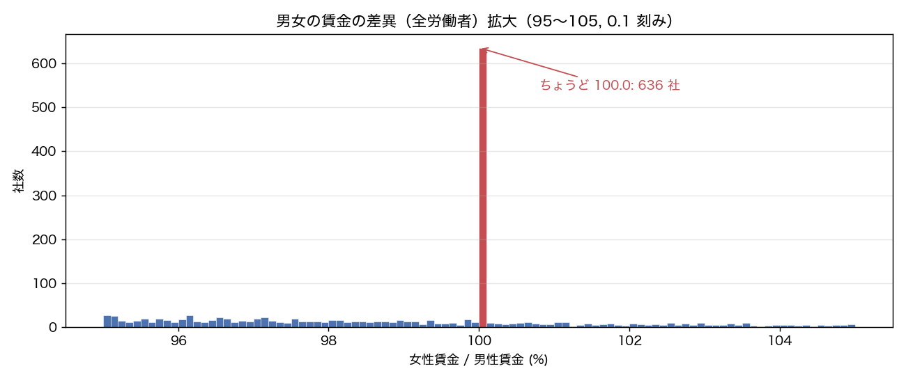
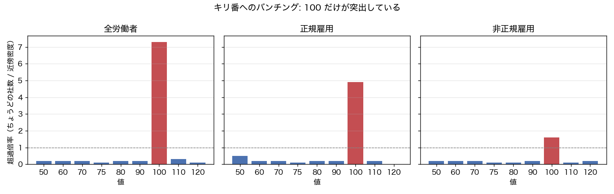
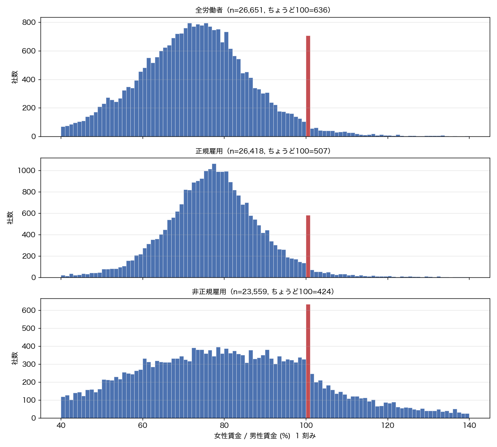
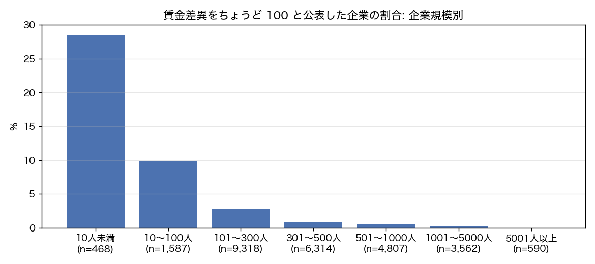

# 男女の賃金の差異「ちょうど 100」へのバンチング分析

出典：女性の活躍推進企業データベースオープンデータ（2026-10-16時点）（https://positive-ryouritsu.mhlw.go.jp/positivedb/opendata/）を加工して作成

## 要約

- 男女の賃金の差異（全労働者）を公表した 26,651 社のうち 636 社（2.4%）が**ちょうど 100.0** を記入している。
- 100 の近傍（±2.5）の密度は 1 ポイント当たり 87 社なので、ちょうど 100 は近傍の **7 倍** のスパイク。他のキリ番（70, 80 など）の超過倍率は 0.3 倍以下で、100 だけが別格。
- 99.5〜100.5 の帯には 716 社いるが、そのうち 636 社が 100.0 ちょうど。「ほぼ同額」ではなく「同額と宣言している」値である。
- 100 と答えた企業は、小規模・非上場に多く、注釈欄に「男女で賃金に差はない」「性別による差はつけていない」と**制度上の差の有無**を書いているケースが目立つ。指標の定義（平均賃金の実績比）とは別の解釈で記入された疑いが強い。
- 全体の中央値・平均への影響は小さい（下表）が、「90 以上」の割合や小規模企業の平均は 100 を含めるかで動く。賃金差異を分析する際は `pay_gap_all_is100` フラグで感度分析することを勧める。

## 1. 分布の形

### 100 周辺の帯別社数

| 帯 | 社数 |
|---|---|
| 95.0〜97.4 | 397 |
| 97.5〜99.9 | 299 |
| ちょうど 100.0 | 636 |
| 100.1〜102.5 | 165 |
| 102.6〜105.0 | 116 |

### キリ番ごとの超過倍率（全労働者）

近傍密度 = ±2.5 ポイント（その値自身を除く）の社数 ÷ 5。値が小数 1 桁で滑らかに分布していれば、ちょうどその値になる社数は近傍密度の 1/10 程度が期待値。

| 値 | ちょうどその値の社数 | 近傍の密度（社/1pt） | 超過倍率 | 全公表社に占める割合(%) |
|---|---|---|---|---|
| 50 | 36 | 207.4 | 0.2 | 0.1 |
| 60 | 75 | 444.8 | 0.2 | 0.3 |
| 70 | 120 | 703.4 | 0.2 | 0.5 |
| 75 | 96 | 747.4 | 0.1 | 0.4 |
| 80 | 130 | 649.6 | 0.2 | 0.5 |
| 90 | 60 | 272.2 | 0.2 | 0.2 |
| 100 | 636 | 87.4 | 7.3 | 2.4 |
| 110 | 7 | 26.8 | 0.3 | 0.0 |
| 120 | 1 | 10.0 | 0.1 | 0.0 |

### 雇用形態別の丸めの度合い

| 対象 | n | 整数値の割合(%) | 5の倍数の割合(%) | 10の倍数の割合(%) | ちょうど100の割合(%) | 100超の割合(%) |
|---|---|---|---|---|---|---|
| 全労働者 | 26,651 | 14.2 | 5.4 | 4.1 | 2.4 | 3.1 |
| 正規雇用 | 26,418 | 13.8 | 4.9 | 3.6 | 1.9 | 2.8 |
| 非正規雇用 | 23,559 | 13.8 | 4.6 | 3.4 | 1.8 | 18.7 |

## 2. どの企業が 100 と答えているか

### 企業規模別

| 企業規模 | 公表社数 | ちょうど100の社数 | 割合(%) |
|---|---|---|---|
| 10人未満 | 468 | 134 | 28.6 |
| 10～100人 | 1,587 | 156 | 9.8 |
| 101～300人 | 9,318 | 259 | 2.8 |
| 301～500人 | 6,314 | 54 | 0.9 |
| 501～1000人 | 4,807 | 27 | 0.6 |
| 1001～5000人 | 3,562 | 6 | 0.2 |
| 5001人以上 | 590 | 0 | 0.0 |

### 上場・非上場

| 区分 | 公表社数 | ちょうど100の社数 | 割合(%) |
|---|---|---|---|
| 非上場 | 24,776 | 635 | 2.6 |
| 上場 | 1,875 | 1 | 0.1 |

### 業種別（公表 100 社以上、割合の高い順）

| 業種 | 公表社数 | ちょうど100の社数 | 割合(%) |
|---|---|---|---|
| 報道 | 172 | 15 | 8.7 |
| 学術研究、専門・技術サービス業 | 555 | 31 | 5.6 |
| 生活関連サービス業、娯楽業 | 416 | 21 | 5.0 |
| 医療、福祉 | 3,824 | 145 | 3.8 |
| 運輸業、郵便業 | 1,460 | 50 | 3.4 |
| 不動産業、物品賃貸業 | 521 | 16 | 3.1 |
| 建設業 | 1,325 | 40 | 3.0 |
| 複合サービス事業 | 285 | 8 | 2.8 |
| 宿泊業、飲食サービス業 | 1,053 | 28 | 2.7 |
| 教育、学習支援業 | 563 | 15 | 2.7 |
| サービス業（他に分類されないもの） | 3,693 | 91 | 2.5 |
| プラスチック製品製造業、ゴム製品製造業 | 162 | 3 | 1.9 |
| 情報通信業 | 1,582 | 29 | 1.8 |
| 分類不能の産業 | 227 | 4 | 1.8 |
| その他製造業 | 3,010 | 52 | 1.7 |
| 卸売業、小売業 | 3,889 | 62 | 1.6 |
| パルプ・紙・紙加工品製造業、印刷業・印刷関連業 | 164 | 2 | 1.2 |
| 食料品、飲料・たばこ・飼料製造業 | 643 | 7 | 1.1 |
| 輸送用機械器具製造業 | 486 | 3 | 0.6 |
| 鉄鋼業、非鉄金属・金属製品製造業 | 383 | 2 | 0.5 |
| 金融業、保険業 | 612 | 3 | 0.5 |
| はん用機械器具・生産用機械器具・業務用機械器具製造業 | 271 | 1 | 0.4 |
| 化学工業 | 408 | 1 | 0.2 |
| 電子部品・デバイス・電子回路・電気機械器具・情報通信機械器具製造業 | 620 | 1 | 0.2 |
| 電気・ガス・熱供給・水道業 | 116 | 0 | 0.0 |

### 都道府県別（公表 100 社以上、上位 10）

| 都道府県 | 公表社数 | ちょうど100の社数 | 割合(%) |
|---|---|---|---|
| 群馬県 | 383 | 19 | 5.0 |
| 熊本県 | 237 | 11 | 4.6 |
| 島根県 | 115 | 5 | 4.3 |
| 栃木県 | 522 | 22 | 4.2 |
| 愛媛県 | 328 | 13 | 4.0 |
| 奈良県 | 156 | 6 | 3.9 |
| 長崎県 | 185 | 7 | 3.8 |
| 福井県 | 192 | 7 | 3.6 |
| 宮崎県 | 163 | 5 | 3.1 |
| 北海道 | 757 | 23 | 3.0 |

## 3. 整合性チェック

### 正規・非正規の値も 100 か

| 項目 | 社数 |
|---|---|
| 全労働者がちょうど100の企業 | 636 |
| 　うち正規雇用も100 | 397 |
| 　うち非正規雇用も100 | 203 |
| 　うち正規・非正規ともに100 | 164 |
| 　うち正規雇用が未記入 | 42 |
| 　うち正規雇用が100以外の値 | 197 |

正規・非正規・全体の 3 つが同時にちょうど 100 になるのは、実績の比としてはほぼあり得ない。3 つとも 100 の企業は「差異なし」と宣言している可能性が高い。

### 単一性別の職場か（女性労働者割合・区分 1）

女性または男性が 0 人なら比は定義できない。そうした企業が便宜的に 100 を置いているかを見る。

| 女性労働者割合 | それ以外 | ちょうど100 | それ以外 (%) | ちょうど100 (%) |
|---|---|---|---|---|
| 0%（女性0人） | 217 | 13 | 0.8 | 2.0 |
| 0超〜10% | 1,508 | 42 | 5.8 | 6.6 |
| 10〜90% | 13,942 | 320 | 53.6 | 50.3 |
| 90超〜100%未満 | 261 | 16 | 1.0 | 2.5 |
| 100%（男性0人） | 118 | 34 | 0.5 | 5.3 |
| 未記入 | 9,969 | 211 | 38.3 | 33.2 |

### 他の指標との比較

| グループ | n | 女性管理職割合を公表(%) | 　うち0%(%) | 　うち100%(%) | 管理職の人数 中央値 | 女性労働者割合 中央値 | 注釈記入率(%) |
|---|---|---|---|---|---|---|---|
| ちょうど100 | 636 | 79.9 | 29.7 | 6.9 | 8 | 50.0 | 34.6 |
| それ以外 | 26,015 | 88.3 | 18.9 | 0.7 | 29 | 31.2 | 37.5 |

## 4. 注釈欄の文言

注釈欄（14. 男女の賃金の差異 注釈・説明）を正規表現で分類した。

| 分類 | それ以外 | ちょうど100 | それ以外 (%) | ちょうど100 (%) |
|---|---|---|---|---|
| 注釈なし | 16,254 | 416 | 62.5 | 65.4 |
| 賃金制度に男女差がない旨の説明 | 2,618 | 148 | 10.1 | 23.3 |
| 計算方法・算出根拠の説明 | 3,454 | 23 | 13.3 | 3.6 |
| 人員構成・勤続年数などによる説明 | 2,496 | 17 | 9.6 | 2.7 |
| その他 | 1,193 | 32 | 4.6 | 5.0 |

100 と記入しつつ注釈に 100 以外の％値（20〜300）を書いている企業: 10 社。入力欄の制約や誤入力で実際の値が反映されていない可能性がある。

### 100 と答えた企業の注釈の典型例（頻度順、60 文字以内）

- 差異なし
- 自社における男女間賃金差異の背景事情・要因の説明及び課題の分析
- 男女の賃金の差異はありません。
- 性差によって賃金を変えることはありません。
- 当社の賃金規定は男女による差はありません
- 男女の賃金の差異はありません
- 性別で賃金に差はつけていません。
- 同一職種・同一等級における賃金テーブルに基づき、性別による賃金差異はありません。
- 男女で賃金体系に差はありません。
- 特に男女を理由とした差はありません。
- 男女賃金差異なし
- 役職・学暦等で差異はあるが基本的には男女関係なく、基本給を定めています。

## 5. 全体統計への影響

### ちょうど 100 を含む／除外した統計

| 対象 | n（含む） | 中央値（含む） | 平均（含む） | n（除外） | 中央値（除外） | 平均（除外） | 90以上の割合（含む）(%) | 90以上の割合（除外）(%) |
|---|---|---|---|---|---|---|---|---|
| 全労働者 | 26,651 | 72.9 | 72.9 | 26,015 | 72.5 | 72.2 | 12.3 | 10.2 |
| 正規雇用 | 26,418 | 77.3 | 77.2 | 25,911 | 77.0 | 76.7 | 13.9 | 12.2 |
| 非正規雇用 | 23,559 | 79.6 | 80.5 | 23,135 | 79.0 | 80.2 | 34.5 | 33.3 |

### 企業規模別（全労働者）

| 企業規模 | n | 中央値（含む） | 中央値（除外） | 平均（含む） | 平均（除外） | 平均の差 |
|---|---|---|---|---|---|---|
| 10人未満 | 468 | 87.8 | 72.0 | 80.2 | 72.2 | 8.0 |
| 10～100人 | 1,587 | 78.4 | 75.7 | 77.4 | 74.9 | 2.5 |
| 101～300人 | 9,318 | 74.3 | 73.9 | 74.3 | 73.6 | 0.7 |
| 301～500人 | 6,314 | 72.4 | 72.2 | 72.5 | 72.3 | 0.2 |
| 501～1000人 | 4,807 | 71.6 | 71.6 | 71.2 | 71.1 | 0.2 |
| 1001～5000人 | 3,562 | 70.4 | 70.4 | 69.8 | 69.7 | 0.1 |
| 5001人以上 | 590 | 69.4 | 69.4 | 69.2 | 69.2 | 0.0 |

## 6. 解釈と推奨

**考えられる原因**

1. 指標の誤解: 「男女の賃金の差異」を、賃金規程に性別による差があるか（ない → 100）と解釈して記入している。注釈欄の文言（「性別による差はつけていない」等）がこれを裏付ける。
2. 計算不能の代替値: 一方の性別が 0 人、あるいは少人数で平均比を出す意味がない企業が 100 を置いている。女性労働者割合が 0% または 100% の企業が「ちょうど 100」群に多いことと整合する。
3. 丸め: 99.6 などを 100 に丸めた企業も一部含まれるが、99.5〜100.5 の帯の中で 100.0 ちょうどの比率が極端に高く、丸めだけでは説明できない。

**分析上の推奨**

- 賃金差異を使う分析では `pay_gap_all_is100`（正規・非正規は `pay_gap_regular_is100` 等）で感度分析する。
- 特に従業員 300 人以下や非上場を対象にする場合、100 の群を除くか別扱いにする。
- 「100 超（女性が高い）」の割合を論じる際は、100 ちょうどを含めないよう帯の境界に注意する。
- 本レポートの数値は自己申告値であり、個社の記入意図を確認したものではない。

---

本レポートは `python -m gender_gap analyze` により自動生成。
